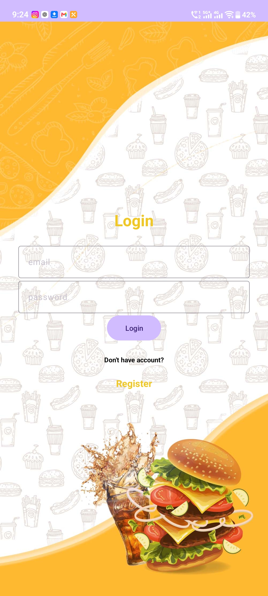
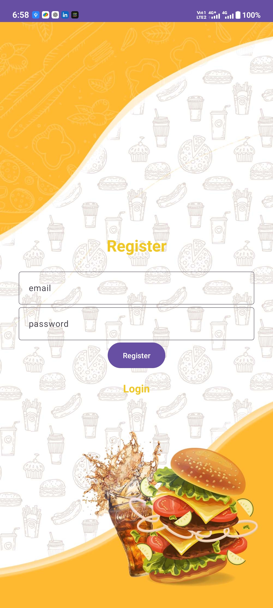
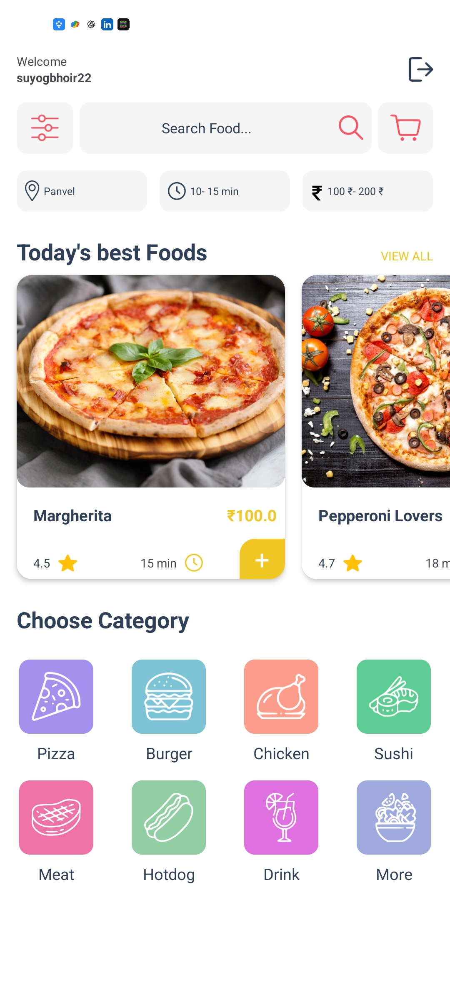
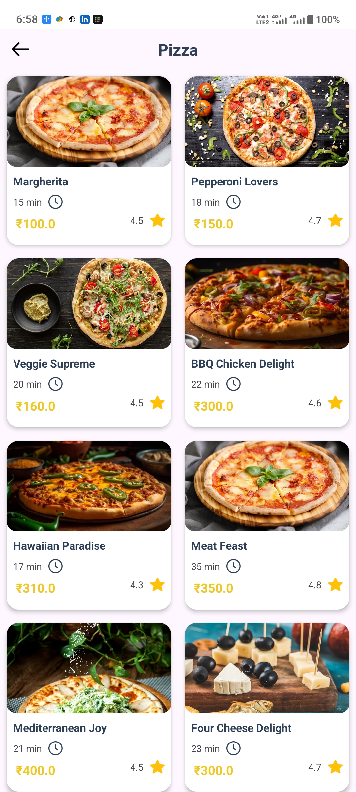
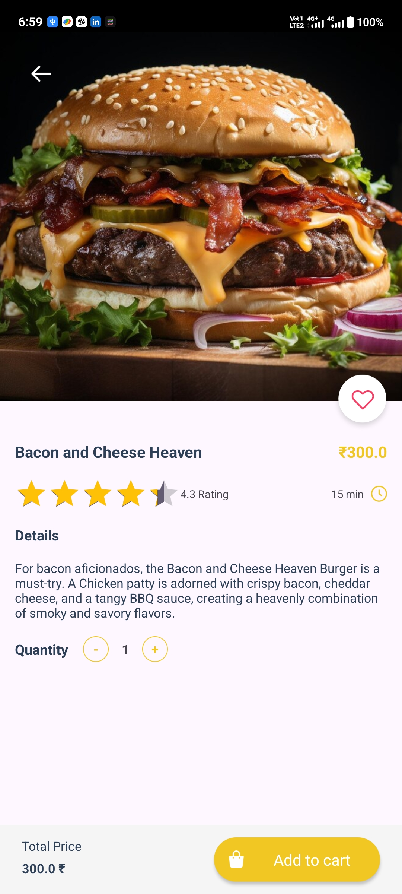

# 🍕 Quick Serve — Food Ordering Android App

Quick Serve is an Android food ordering application developed as my final-year BSc project. I recently recovered the project and made a few changes while revisiting my earlier work.

## 📱 About the Project

The app provides a simple interface for browsing food items, exploring categories, viewing food details, managing cart quantities, and accessing the payment screen.

I developed the login and payment UI and adapted parts of the original project for my requirements.

## ✨ Features

- User login and registration
- Browse food items and categories
- View food details, prices, and ratings
- Add food items to the cart and update quantities
- View the order summary
- Payment method selection UI
- Prices displayed in Indian Rupees (₹)

📱 Screenshots

Login Screen

  
  

  
  
  

Registration Screen

Home Screen

Menu Screen

Food Selection Screen

## 🛠️ Built With

- **Java** — Application logic
- **XML** — User interface layouts
- **Android Studio** — Development environment
- **Firebase** — Authentication and database services
- **Glide** — Image loading

## 🎓 Learning Journey

This project began as my final-year BSc project. At the time, I was new to Android development and learned by following online tutorials. After recovering the project, I revisited the code, made changes, and continued learning through hands-on practice.

## 🙌 Credits

The original implementation was developed with help from Android development tutorials by **UI Lover** on YouTube. This repository builds on that learning experience, alongside my own work on the login and payment interfaces and other changes.

## 🚀 Getting Started

1. Clone or download this repository.
2. Open the project in Android Studio.
3. Allow Gradle to sync.
4. Configure your own Firebase project and add the required `google-services.json` file if needed.
5. Run the app on an Android emulator or compatible device.

**Note:** Firebase configuration and any required services must be set up correctly for the app to work.

## 📌 Project Status

This is a learning project that I recovered and updated as part of my continued Android development journey.

---

Made with ☕ and a love for learning Android development.
